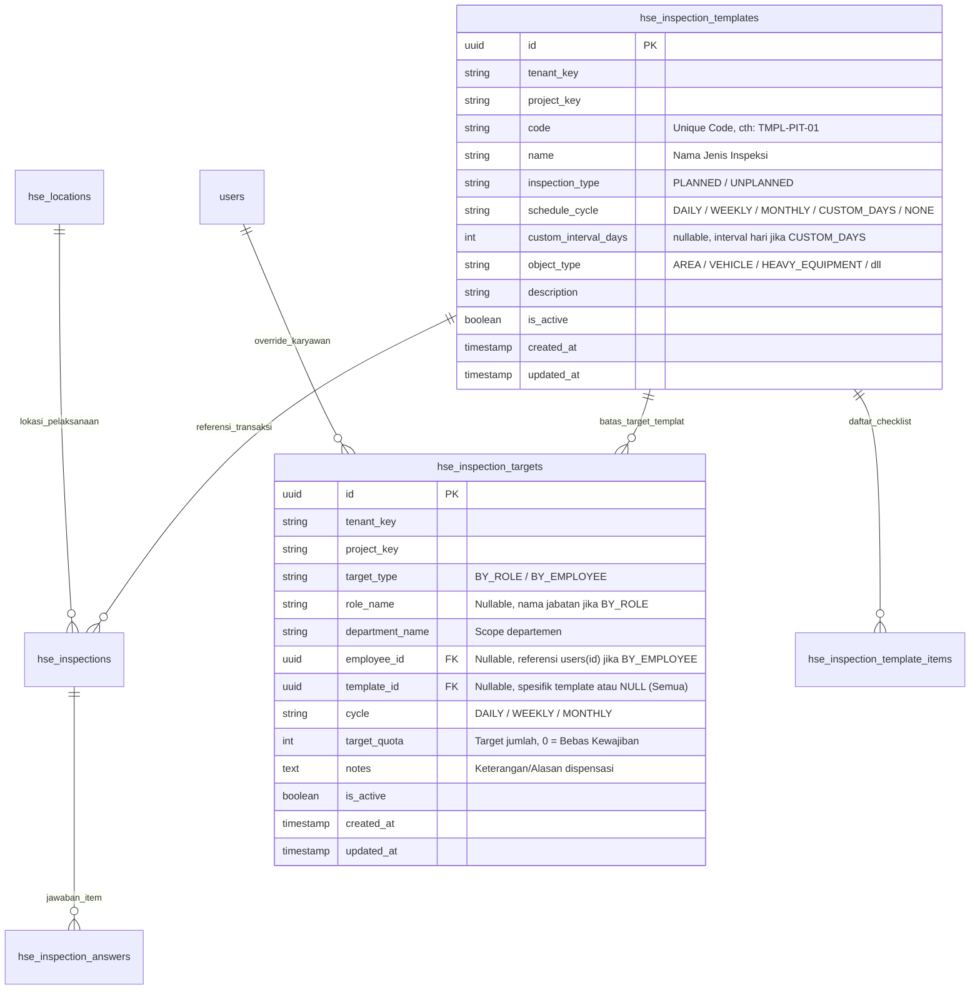

# Rencana Desain & Rekomendasi Setup Inspeksi HSE (OMOS Mining OS)

Dokumen ini mendefinisikan spesifikasi arsitektur, struktur database, logika bisnis, dan tata letak antarmuka pengguna (UI/UX) untuk penambahan sub-halaman **Setup Inspeksi** di dalam modul **Setup Master (Konfigurasi HSE)** pada sistem OMOS.

---

## 1. Latar Belakang & Analisis Kebutuhan

Berdasarkan ketentuan **SMKP Minerba (Kepmen ESDM No. 1827 K/30/MEM/2018 Lampiran IV)**, inspeksi keselamatan pertambangan adalah instrumen proaktif utama untuk mengidentifikasi bahaya di tempat kerja dan memastikan kepatuhan standar operasional.

Dalam implementasi lapangan, pengelolaan inspeksi memiliki 3 karakteristik utama:
1. **Sifat Inspeksi Berbeda**:
   - **Terencana (Planned Inspection)**: Terjadwal secara periodik dengan templat checklist terstruktur (contoh: Inspeksi Front Loading, Inspeksi APAR, Inspeksi Workshop 5R).
   - **Tidak Terencana (Unplanned / Ad-hoc / Insidental)**: Berupa inspeksi mendadak (*spot check*), sidak kepatuhan K3, atau inspeksi pasca-laporan bahaya tanpa siklus tetap.
2. **Siklus / Frekuensi Beragam**:
   - **Harian (Daily)**: Pre-shift inspection, daily pit tour.
   - **Mingguan (Weekly)**: Inspeksi housekeeping bengkel, drainase/sump.
   - **Bulanan (Monthly)**: Inspeksi sarana tanggap darurat, grounding, APAR.
   - **Periode Tertentu (Custom Interval)**: Interval hari khusus (misal: tiap 14 hari, triwulan/90 hari, atau semesteran).
   - **Non-Jadwal (None / Ad-hoc)**: Khusus inspeksi tidak terencana.
3. **Kewajiban Inspeksi Karyawan Bervariasi (Termasuk Kuota 0)**:
   - Tanggung jawab inspeksi keselamatan umumnya dibebankan kepada **Pengawas Operasional (Group Leader / Supervisor / Superintendent)** dan tim HSE.
   - Karyawan non-pengawas (Operator, Driver, Mekanik, Staf Administrasi) memiliki kewajiban inspeksi formal bernilai **0 (Bebas Kewajiban)**.
   - Diperlukan mekanisme penentuan target yang efisien tanpa harus menginput ratusan karyawan secara manual satu per satu.

---

## 2. Pendekatan Logika & Arsitektur Solusi

### 2.1. Arsitektur Matriks Kewajiban (2-Tier Target Mandate)
Untuk memberikan efisiensi tinggi bagi Administrator HSE:
* **Tier 1 — Default Berdasarkan Jabatan (Role-Based Default)**:
  - Admin dapat menetapkan target standar untuk suatu jabatan dalam departemen.
  - *Contoh*: Jabatan `Supervisor Pit` $\rightarrow$ Target 4x per Bulan. Jabatan `Operator Dump Truck` $\rightarrow$ Target 0 (Bebas Kewajiban).
* **Tier 2 — Override Khusus Individu (Individual Exception)**:
  - Digunakan jika ada personil tertentu yang memiliki target khusus berbeda dari rekan sejabatannya (misal: ditunjuk sebagai Safety Champion departemen sehingga dinaikkan targetnya, atau pengawas yang sedang cuti panjang/tugas khusus sehingga diatur target 0).
  - *Hierarki Evaluasi*: Jika ada entri *Individual Override*, sistem memprioritaskan nilai tersebut; jika tidak ada, sistem otomatis mengacu pada *Role Default*.

---

## 3. Desain Struktur Data (Database Schema)

### 3.1. Relasi Entity-Relationship (ERD)



### 3.2. Spesifikasi DDL (Data Definition Language)

```sql
-- 1. Perluasan Tabel Master Templat Inspeksi (hse_inspection_templates)
ALTER TABLE hse_inspection_templates 
ADD COLUMN IF NOT EXISTS inspection_type TEXT NOT NULL DEFAULT 'PLANNED' 
  CHECK (inspection_type IN ('PLANNED', 'UNPLANNED')),
ADD COLUMN IF NOT EXISTS schedule_cycle TEXT NOT NULL DEFAULT 'MONTHLY' 
  CHECK (schedule_cycle IN ('DAILY', 'WEEKLY', 'MONTHLY', 'CUSTOM_DAYS', 'NONE')),
ADD COLUMN IF NOT EXISTS custom_interval_days INTEGER DEFAULT NULL;

COMMENT ON COLUMN hse_inspection_templates.inspection_type IS 'Sifat inspeksi: PLANNED (Terencana) atau UNPLANNED (Tidak terencana / Ad-hoc)';
COMMENT ON COLUMN hse_inspection_templates.schedule_cycle IS 'Siklus inspeksi rutin: DAILY, WEEKLY, MONTHLY, CUSTOM_DAYS, atau NONE';
COMMENT ON COLUMN hse_inspection_templates.custom_interval_days IS 'Jumlah interval hari bila siklus CUSTOM_DAYS (misal: 14)';

-- 2. Pembuatan Tabel Matriks Kewajiban Inspeksi (hse_inspection_targets)
CREATE TABLE IF NOT EXISTS hse_inspection_targets (
  id UUID PRIMARY KEY DEFAULT gen_random_uuid(),
  tenant_key TEXT NOT NULL DEFAULT 'default',
  project_key TEXT NOT NULL DEFAULT 'default',
  target_type TEXT NOT NULL CHECK (target_type IN ('BY_ROLE', 'BY_EMPLOYEE')),
  role_name TEXT,
  department_name TEXT,
  employee_id UUID REFERENCES users(id) ON DELETE CASCADE,
  template_id UUID REFERENCES hse_inspection_templates(id) ON DELETE CASCADE,
  cycle TEXT NOT NULL DEFAULT 'MONTHLY' CHECK (cycle IN ('DAILY', 'WEEKLY', 'MONTHLY')),
  target_quota INTEGER NOT NULL DEFAULT 1 CHECK (target_quota >= 0),
  notes TEXT,
  is_active BOOLEAN NOT NULL DEFAULT TRUE,
  created_at TIMESTAMPTZ NOT NULL DEFAULT CURRENT_TIMESTAMP,
  updated_at TIMESTAMPTZ NOT NULL DEFAULT CURRENT_TIMESTAMP,
  deleted_at TIMESTAMPTZ,
  CONSTRAINT uq_role_target UNIQUE NULLS NOT DISTINCT (
    tenant_key, project_key, target_type, role_name, department_name, template_id, cycle
  ),
  CONSTRAINT uq_emp_target UNIQUE NULLS NOT DISTINCT (
    tenant_key, project_key, target_type, employee_id, template_id, cycle
  )
);

CREATE INDEX IF NOT EXISTS idx_hse_insp_target_scope ON hse_inspection_targets(tenant_key, project_key, target_type);
CREATE INDEX IF NOT EXISTS idx_hse_insp_target_emp ON hse_inspection_targets(employee_id);
CREATE INDEX IF NOT EXISTS idx_hse_insp_target_tmpl ON hse_inspection_targets(template_id);
```

---

## 4. Desain Antarmuka Pengguna (UI / UX Layout)

### 4.1. Navigasi Internal di Setup Master
Di header halaman **Setup Master**, terdapat *Pill Tab Switcher* horizontal:
- `[ Tab: Area & Sub Area ]` (Hierarki lokasi tambang)
- `[ Tab: Setup Inspeksi ]` (Konfigurasi master templat & kewajiban karyawan)

---

### 4.2. Tampilan Sub-Tab 1: Jenis & Siklus Inspeksi
Tampilan manajemen jenis inspeksi dengan filter dan badge visual informatif:

```
┌─────────────────────────────────────────────────────────────────────────────────────────────────────────────────┐
│  Setup Master  >  Inspeksi  >  [• Jenis & Siklus Inspeksi]  [  Matriks Kewajiban Karyawan]                      │
├─────────────────────────────────────────────────────────────────────────────────────────────────────────────────┤
│  Toolbar:                                                                                                       │
│  [+ Tambah Jenis Inspeksi]    [Semua Sifat ▼]  [Semua Siklus ▼]  [Filter Objek ▼]  [🔍 Cari Kode / Nama...]      │
├─────────────────────────────────────────────────────────────────────────────────────────────────────────────────┤
│  DAFTAR TEMPLAT INSPEKSI (Total: 4 Jenis Aktif)                                                                 │
│                                                                                                                 │
│  ┌───────────────────────┬──────────────┬──────────────┬──────────────────┬────────────┬──────────┬───────────┐ │
│  │ Kode & Nama Inspeksi  │ Sifat        │ Siklus       │ Objek Pengawasan │ Checklist  │ Status   │ Aksi      │ │
│  ├───────────────────────┼──────────────┼──────────────┼──────────────────┼────────────┼──────────┼───────────┤ │
│  │ TMPL-PIT-01           │ [Terencana]  │ [Harian]     │ AREA             │ 14 Butir   │ [Aktif]  │ [✏️] [🗑️]  │ │
│  │ Inspeksi Pit Harian   │ (Badge Biru) │ (Hijau)      │ Pit & Disposal   │ (3 Kritis) │ (Hijau)  │           │ │
│  ├───────────────────────┼──────────────┼──────────────┼──────────────────┼────────────┼──────────┼───────────┤ │
│  │ TMPL-WSHOP-01         │ [Terencana]  │ [Mingguan]   │ AREA             │ 18 Butir   │ [Aktif]  │ [✏️] [🗑️]  │ │
│  │ Inspeksi Housekeeping │ (Badge Biru) │ (Kuning)     │ Workshop & Gudang│ (2 Kritis) │ (Hijau)  │           │ │
│  ├───────────────────────┼──────────────┼──────────────┼──────────────────┼────────────┼──────────┼───────────┤ │
│  │ TMPL-APAR-01          │ [Terencana]  │ [Bulanan]    │ FIRE_EQUIPMENT   │ 8 Butir    │ [Aktif]  │ [✏️] [🗑️]  │ │
│  │ Cek Fisik APAR Site   │ (Badge Biru) │ (Oranye)     │ Tabung APAR Site │ (4 Kritis) │ (Hijau)  │           │ │
│  ├───────────────────────┼──────────────┼──────────────┼──────────────────┼────────────┼──────────┼───────────┤ │
│  │ TMPL-SDAK-01          │ [Tdk Rencana]│ [Insidental] │ Sarana Tambang   │ 10 Butir   │ [Aktif]  │ [✏️] [🗑️]  │ │
│  │ Sidak K3 & Kelayakan  │ (Badge Ungu) │ (Abu-abu)    │ Seluruh Lokasi   │ (1 Kritis) │ (Hijau)  │           │ │
│  └───────────────────────┴──────────────┴──────────────┴──────────────────┴────────────┴──────────┴───────────┘ │
└─────────────────────────────────────────────────────────────────────────────────────────────────────────────────┘
```

---

### 4.3. Tampilan Sub-Tab 2: Matriks Kewajiban Karyawan (Quota Matrix)
Tampilan untuk mengontrol target kewajiban per pengawas dan status bebas kewajiban:

```
┌─────────────────────────────────────────────────────────────────────────────────────────────────────────────────┐
│  Setup Master  >  Inspeksi  >  [  Jenis & Siklus Inspeksi]  [• Matriks Kewajiban Karyawan]                      │
├─────────────────────────────────────────────────────────────────────────────────────────────────────────────────┤
│  Ringkasan KPI Kewajiban:                                                                                       │
│  [ Total Personil: 145 ]   [ Wajib Inspeksi: 24 Pengawas ]   [ Bebas Kewajiban (0): 121 Karyawan ]              │
├─────────────────────────────────────────────────────────────────────────────────────────────────────────────────┤
│  Toolbar Aksi:                                                                                                  │
│  [+ Atur Default per Jabatan]  [+ Override Khusus Karyawan]  [Semua Dept ▼]  [Semua Status ▼]  [🔍 Cari...]     │
├─────────────────────────────────────────────────────────────────────────────────────────────────────────────────┤
│  MATRIKS TARGET KEWAJIBAN                                                                                       │
│                                                                                                                 │
│  ┌───────────────────────┬──────────────┬──────────────────┬──────────────┬─────────────────┬─────────────────┐ │
│  │ Karyawan / NIK        │ Departemen   │ Jabatan          │ Target Kuota │ Sumber Aturan   │ Aksi            │ │
│  ├───────────────────────┼──────────────┼──────────────────┼──────────────┼─────────────────┼─────────────────┐ │
│  │ Ahmad Fauzi           │ Produksi     │ Supervisor Pit   │ 4x / Bulan   │ Default Jabatan │ [Sesuaikan] [⚙️]│ │
│  │ NIK: PIM-0192         │              │                  │ (Badge Hijau)│                 │                 │ │
│  ├───────────────────────┼──────────────┼──────────────────┼──────────────┼─────────────────┼─────────────────┐ │
│  │ Budi Santoso          │ SHE          │ Safety Officer   │ 8x / Bulan   │ Individual      │ [Sesuaikan] [⚙️]│ │
│  │ NIK: PIM-0105         │              │                  │ (Badge Biru) │ (Override PIC)  │                 │ │
│  ├───────────────────────┼──────────────┼──────────────────┼──────────────┼─────────────────┼─────────────────┐ │
│  │ Dedi Irawan           │ Produksi     │ Operator DT      │ Bebas (0)    │ Default Jabatan │ [Beri Target]   │ │
│  │ NIK: PIM-0441         │              │                  │ (Badge Abu)  │                 │                 │ │
│  └───────────────────────┴──────────────┴──────────────────┴──────────────┴─────────────────┴─────────────────┘ │
└─────────────────────────────────────────────────────────────────────────────────────────────────────────────────┘
```

---

## 5. Spesifikasi Alur Kerja & Form Input (Modal Modals)

### 5.1. Modal Form "Tambah / Edit Jenis Inspeksi"
- **Kode Templat***: Input teks kapital (contoh: `TMPL-PIT-01`).
- **Nama Inspeksi***: Input teks lengkap (contoh: `Inspeksi Keselamatan Front Loading Pit`).
- **Sifat Inspeksi***: Segmented Control / Radio:
  - `Terencana (Planned)`: Menampilkan dropdown siklus wajib.
  - `Tidak Terencana (Unplanned / Ad-hoc)`: Siklus otomatis dikunci ke `Insidental (Tanpa Jadwal Rutin)`.
- **Siklus Inspeksi**: Dropdown (Harian, Mingguan, Bulanan, Custom Hari).
- **Interval Hari**: Input angka (hanya tampil jika siklus = `Custom Hari`, misal `14`).
- **Objek Inspeksi***: Dropdown pilihan (`AREA`, `HEAVY_EQUIPMENT`, `VEHICLE`, `ELECTRICAL`, `FIRE_EQUIPMENT`, `HAZMAT_STORAGE`, `OTHER`).
- **Checklist Item Builder**:
  - Kolom pertanyaan checklist.
  - Checkbox toggle `Item Kritis (Critical)`.
  - Input panduan / instruksi verifikasi (*guidance*).
  - Tombol tambah & hapus butir pertanyaan.

---

### 5.2. Modal Form "Atur Default per Jabatan"
- **Pilih Departemen***: Dropdown departemen (contoh: `Produksi`, `Plant/Maintenance`, `SHE`).
- **Pilih Jabatan***: Dropdown jabatan (contoh: `Supervisor Pit`, `Foreman`, `Group Leader`).
- **Jenis Inspeksi**: Pilihan `Semua Jenis Inspeksi` atau pilih templat spesifik.
- **Siklus Periode**: Dropdown (`Mingguan` atau `Bulanan`).
- **Target Kuota (Jumlah Inspeksi)***: Input angka numerik:
  - Isi `4` $\rightarrow$ Wajib 4 kali per siklus.
  - Isi `0` $\rightarrow$ Bebas kewajiban inspeksi bagi seluruh personil di jabatan tersebut.
- **Catatan / Regulasi**: Keterangan acuan (contoh: *Mengacu SOP-K3-04 Pengawasan Harian*).

---

### 5.3. Modal Form "Override Khusus Karyawan"
- **Pilih Karyawan***: Dropdown pencarian karyawan aktif (`Nama — NIK — Jabatan [Dept]`).
- **Target Kuota Khusus***: Input angka numerik (dapat diset `0` untuk dispensasi atau angka tertentu untuk target khusus).
- **Alasan / Catatan Override**: Input keterangan (contoh: *Ditunjuk sebagai Koordinator K3 Lapangan*, atau *Dispensasi pemulihan medis / bebas inspeksi*).

---

## 6. Rencana Tahapan Eksekusi

| Tahap | Tindakan Teknis | Luaran / Verifikasi |
|---|---|---|
| **Fase 1** | Buat file migrasi SQL: `backend/migrations/084_hse_setup_inspections.sql` | Penambahan kolom pada `hse_inspection_templates` & tabel baru `hse_inspection_targets`. |
| **Fase 2** | Eksekusi runner migrasi database lokal | Struktur database aktif dan terindeks dengan benar. |
| **Fase 3** | Implementasi Service & Route Backend di `backend/src/services/hse.js` dan `hse.routes.js` | Endpoint CRUD templat inspeksi, siklus, target per jabatan, dan override karyawan. |
| **Fase 4** | Integrasi UI di `admin-dashboard/hse.js` & `hse.css` | Tampilan Sub-Tab Navigasi di Setup Master, tabel templat, matriks kuota karyawan, dan modal form. |
| **Fase 5** | Pembaruan Fixture & Unit Testing | Suite `backend/test/hse.test.js` dan `admin-dashboard/hse.test.js` lulus 100%. |

---

*Dokumen ini merupakan panduan implementasi resmi untuk pengembangan fitur Setup Inspeksi HSE di OMOS.*
