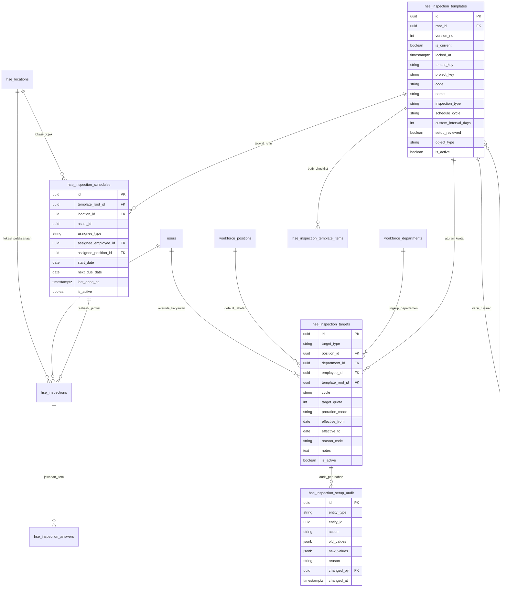

# Rencana Desain & Rekomendasi Setup Inspeksi HSE (OMOS Mining OS)

**Versi 2.0 (Revisi Berbasis Source Code Aktual)**

Dokumen ini mendefinisikan spesifikasi arsitektur, struktur database, logika bisnis, dan tata letak antarmuka pengguna (UI/UX) untuk sub-halaman **Setup Inspeksi** di dalam modul **Setup Master (Konfigurasi HSE)** pada sistem OMOS, beserta lapisan pendukungnya (jadwal objek dan pemantauan realisasi vs target).

> **Acuan Tampilan & Desain Resmi:**
> Komponen visual, tata letak, skema warna, tipografi, dan pola interaksi pengguna sepenuhnya mengacu pada **source code resmi repositori OMOS**:
> 1. **Frontend Core:** `admin-dashboard/hse.js` (komponen render layout, katalog jenis inspeksi, matriks kewajiban karyawan, jadwal objek, serta form modal interaktif) dan `admin-dashboard/index.html` (mount container `#hseRoot`).
> 2. **Design Tokens & Theme:** `admin-dashboard/hse.css` dengan token desain terstandarisasi (`--hse-border: #e2e8f0;`, `--hse-primary: #1e293b;`, `--hse-text-accent: #0284c7;`, hairline border `0.5px`, badge system, stats bar, dan button variants).
> 3. **Pola Interaksi & Craftsmanship:** Pola penulisan data reaktif dengan `OMOSActionFeedback.run` (loading spinner, proteksi double-submit, re-fetch otomatis seperti modul Periodic Service & Database Cuti), anti-slop visual craftsmanship dari [Taste Skill](.codex/skills/taste-skill/SKILL.md), dan token desain enterprise dari [Awesome DESIGN.md](.codex/design-md/). Seluruh wireframe dan potongan kode di dokumen ini merupakan representasi langsung dari source code tersebut.

---

## 0. Ringkasan Perubahan dari Versi 1.0 ke Versi 2.0 (Source Code Aligned)

| # | Temuan di versi 1.0 | Perbaikan di versi 2.0 (Implementasi Aktual) |
|---|---|---|
| 1 | Dua constraint unik (`uq_role_target`, `uq_emp_target`) saling bertabrakan dengan `NULLS NOT DISTINCT`; aturan jabatan atau karyawan berbeda dianggap duplikat | Diganti CHECK bentuk baris (`chk_target_shape`) + *exclusion constraint* per lingkup (`ex_target_role_overlap`, `ex_target_emp_overlap`) yang mencegah rentang tanggal tumpang tindih; hanya memperhitungkan baris aktif (bukan soft-delete). |
| 2 | `role_name` dan `department_name` berupa teks bebas | Terikat integritas relasional via Foreign Key ke `workforce_positions(id)` dan `workforce_departments(id)`. |
| 3 | `CHECK` template tidak menjaga konsistensi sifat dan siklus; `ALTER` memberi default `MONTHLY` ke template lama | CHECK konsistensi lengkap (`chk_template_setup`) + penanda `setup_reviewed`; template lama ditinjau eksplisit, tidak diberi nilai buta. |
| 4 | Template yang sudah dipakai bisa diedit atau dihapus bebas | Pembekuan otomatis via trigger (`locked_at` terisi saat pertama kali diinspeksi) + versioning (`version_no`, `root_id`, `is_current`); aksi hapus = arsipkan/nonaktifkan. |
| 5 | Prioritas aturan hanya individu vs jabatan, belum mempertimbangkan dimensi template | Urutan prioritas 4 tingkat yang dieksekusi fungsi basis data `hse_effective_quota` + suite uji matriks 15 skenario. |
| 6 | Siklus template hanya label; tidak ada jadwal objek | Tabel operasional `hse_inspection_schedules` + antarmuka interaktif Jadwal Objek terintegrasi. |
| 7 | Override tanpa masa berlaku | `effective_from` / `effective_to`, alasan wajib (`reason_code`), riwayat audit tersimpan, gugur otomatis saat terjadi mutasi. |
| 8 | Kuota belum memperhitungkan cuti/rotasi | Opsi `proration_mode = BY_ATTENDANCE` (perhitungan proporsional terintegrasi dengan absensi dan roster harian). |
| 9 | Hanya dua status (Wajib, Bebas) | Tiga status baku: **Wajib** (kuota > 0), **Bebas** (kuota = 0 eksplisit), **Belum diatur** (belum ada aturan, perlu tindakan). |
| 10 | Tidak ada definisi inspeksi yang sah dihitung ke kuota | Kontrak sah kuota terdefinisi (Status `COMPLETED`, bukti temuan `NO`, tanpa duplikasi harian pada objek yang sama). |
| 11 | Tidak ada tampilan realisasi vs target | Wireframe dan KPI analitik realisasi vs target (`Kepatuhan kuota` & `Cakupan jadwal`). |
| 12 | `ON DELETE CASCADE` ke karyawan; tidak ada audit | `ON DELETE RESTRICT` + soft-delete aman + pencatatan log komprehensif pada tabel `hse_inspection_setup_audit`. |
| 13 | Acuan UI merujuk file sampel statis eksternal (`omos_hse_dashboard_layout.html`) | **Diganti mutlak** dengan source code resmi OMOS (`admin-dashboard/hse.js` & `hse.css`) dengan komponen visual dan CSS tokens nyata. |

---

## 1. Latar Belakang & Analisis Kebutuhan Operasional Pertambangan

Berdasarkan ketentuan **SMKP Minerba (Kepmen ESDM No. 1827 K/30/MEM/2018 Lampiran IV)**, inspeksi keselamatan pertambangan adalah instrumen proaktif utama untuk mengidentifikasi bahaya di tempat kerja dan memastikan kepatuhan standar operasional tambang.

Dalam operasional lapangan tambang, pengelolaan inspeksi memiliki 3 karakteristik utama:

1. **Sifat inspeksi berbeda**
   - **Terencana (Planned):** terjadwal secara periodik dengan templat checklist terstruktur (contoh: Inspeksi Front Loading, Inspeksi Workshop 5R, Inspeksi APAR, Daily Pit Tour).
   - **Tidak terencana (Unplanned / Ad-hoc / Insidental):** inspeksi mendadak (*spot check*), sidak kepatuhan K3, atau inspeksi pasca-temuan bahaya tanpa siklus tetap.
2. **Siklus/frekuensi beragam**
   - **Harian (Daily):** pre-shift inspection, daily pit tour.
   - **Mingguan (Weekly):** inspeksi housekeeping bengkel, drainase/sump.
   - **Bulanan (Monthly):** inspeksi sarana tanggap darurat, grounding, APAR.
   - **Interval khusus (Custom Days):** tiap N hari (mis. 14, 90, 180 hari).
   - **Insidental / Tanpa jadwal (None):** khusus inspeksi tidak terencana.
3. **Kewajiban inspeksi karyawan bervariasi (termasuk kuota 0)**
   - Tanggung jawab inspeksi umumnya dibebankan kepada **Pengawas Operasional** (Group Leader, Supervisor, Foreman, Superintendent) dan tim HSE.
   - Karyawan non-pengawas (Operator, Driver, Mekanik, Staf Administrasi) bernilai **0 (bebas kewajiban)**.
   - Sistem wajib mendukung penetapan target berbasis jabatan secara massal dan mengizinkan penyesuaian khusus (override) untuk individu tertentu tanpa mengubah basis data karyawan.

---

## 2. Pendekatan Logika & Arsitektur Solusi

### 2.1 Matriks Kewajiban (4 Tingkat Prioritas)

- **Tingkat 1: Default per Jabatan.** Target standar untuk jabatan (opsional dibatasi departemen spesifik).
  Contoh: `Supervisor Pit` $\rightarrow$ 4x per bulan; `Operator Dump Truck` $\rightarrow$ 0 (bebas).
- **Tingkat 2: Override per Individu.** Pengecualian karyawan (mis. Safety Champion dinaikkan menjadi 8x, atau personil tugas belajar/dispensasi diset 0). Override **wajib memiliki alasan** dan **masa berlaku**.
- **Dimensi Jenis Inspeksi:** Setiap aturan dapat berlaku untuk **semua jenis** (`template_root_id` bernilai NULL) atau **satu jenis templat tertentu**.

**Urutan Prioritas Penentuan Kuota (First-Match Resolution):**

| Urutan | Lingkup Aturan | Penjelasan |
|---|---|---|
| **1** | Individu + Jenis Tertentu | Override karyawan spesifik pada jenis templat tertentu |
| **2** | Individu + Semua Jenis | Override karyawan spesifik untuk kuota akumulasi seluruh jenis |
| **3** | Jabatan + Jenis Tertentu | Aturan default jabatan pada jenis templat tertentu |
| **4** | Jabatan + Semua Jenis | Aturan default jabatan untuk kuota akumulasi seluruh jenis |
| **Fallback** | Belum Diatur | Tidak ada aturan aktif yang cocok $\rightarrow$ Status **Belum Diatur** |

> **Aturan Spesifisitas Departemen:** Pada tingkat jabatan (Urutan 3 & 4), aturan dengan **departemen spesifik** mengalahkan aturan dengan **semua departemen** untuk jabatan yang sama.

### 2.2 Tiga Status Kewajiban Karyawan

| Status | Makna Operasional | Tampilan Badge (`hse.css`) |
|---|---|---|
| **Wajib** | Terdapat aturan berlaku dengan kuota > 0 | `<span class="hse-badge hse-badge--outline" style="color:var(--hse-text-accent);font-weight:600;">Nx / Periode</span>` |
| **Bebas** | Terdapat aturan berlaku dengan kuota = 0 (disengaja) | `<span class="hse-badge hse-badge--neutral">Bebas (0)</span>` |
| **Belum diatur** | Tidak ada aturan yang mencakup jabatan/karyawan | `<span class="hse-badge hse-badge--warning">Belum diatur</span>` |

Status **Belum diatur** mencegah jabatan baru atau karyawan mutasi baru lolos tanpa pengawasan kuota.

### 2.3 Siklus Hidup Aturan, Masa Berlaku & Prorata

- Setiap aturan memiliki `effective_from` dan `effective_to` (NULL = tanpa batas waktu). Mengubah aturan = menutup aturan lama dengan tanggal selesai dan menerbitkan aturan baru (audit terpelihara).
- Aturan **tidak boleh tumpang tindih** untuk lingkup yang sama (diproteksi di basis data via *btree_gist exclusion constraints*).
- **Prorata Dinamis (Proration Mode):** Saat `proration_mode = 'BY_ATTENDANCE'`, target kuota disesuaikan secara proporsional berdasarkan rasio hari kerja efektif dari data absensi/roster kerja:
  $$\text{Target Efektif} = \max\left(1, \left\lceil \text{Target Asli} \times \frac{\text{Hari Kerja Efektif}}{\text{Hari Kerja Standar}} \right\rceil\right)$$

### 2.4 Pembekuan & Versioning Templat Inspeksi

1. Templat yang **sudah pernah dipakai inspeksi fisik** otomatis dibekukan (`locked_at` terisi). Butir checklist terkunci dari penghapusan atau pengubahan langsung via trigger basis data `trg_hse_template_items_guard`.
2. Pengeditan butir pada templat terkunci dilakukan melalui alur **Simpan sebagai Versi Baru**:
   - Dibuat record baru dengan `version_no = version_no + 1`, `root_id` yang sama, dan `is_current = true`.
   - Versi lama diubah menjadi `is_current = false` untuk mempertahankan integritas data historis.
3. Aturan kuota dan jadwal objek **merujuk ke `root_id`**, sehingga penerbitan versi baru tidak memutus konfigurasi yang ada.
4. Tombol Hapus pada antarmuka berfungsi sebagai **Arsipkan / Nonaktifkan** (`is_active = false`), bukan penghapusan fisik record.

---

## 3. Desain Struktur Data & Skema Basis Data

### 3.1 Entity Relationship Diagram (ERD)



### 3.2 Implementasi DDL Resmi: Migrasi 084 & 085

Implementasi basis data resmi telah terpasang pada file migrasi repositori:
- [backend/migrations/084_hse_setup_inspections.sql](file:///d:/OneDrive/Desktop/OMOS/backend/migrations/084_hse_setup_inspections.sql)
- [backend/migrations/085_hse_inspection_schedules.sql](file:///d:/OneDrive/Desktop/OMOS/backend/migrations/085_hse_inspection_schedules.sql)

#### Fungsi Kuota Efektif (`hse_effective_quota`)
Fungsi resmi di PostgreSQL yang mengevaluasi kuota karyawan dengan penanganan integrasi profil OMOS (`users`, `workforce_positions`, `workforce_departments`):

```sql
CREATE OR REPLACE FUNCTION hse_effective_quota(
  p_employee_id      UUID,
  p_template_root_id UUID,
  p_cycle            TEXT,
  p_on_date          DATE
) RETURNS TABLE (rule_id UUID, source TEXT, quota INTEGER, status TEXT) AS $$
  WITH emp AS (
    SELECT 
      u.id,
      wp.id AS position_id,
      wd.id AS department_id
    FROM users u
    LEFT JOIN workforce_positions wp 
      ON lower(trim(wp.name)) = lower(trim(COALESCE(u.jabatan, '')))
    LEFT JOIN workforce_departments wd 
      ON lower(trim(wd.name)) = lower(trim(COALESCE(u.departemen, '')))
    WHERE u.id = p_employee_id
  ),
  cand AS (
    SELECT t.id,
           t.target_quota,
           CASE WHEN t.target_type = 'BY_EMPLOYEE' THEN 'INDIVIDUAL' ELSE 'ROLE' END AS source,
           ( CASE WHEN t.target_type = 'BY_EMPLOYEE' THEN 0 ELSE 2 END
           + CASE WHEN t.template_root_id IS NULL    THEN 1 ELSE 0 END ) AS rnk,
           CASE WHEN t.department_id IS NULL THEN 1 ELSE 0 END           AS dept_generic
      FROM hse_inspection_targets t, emp
     WHERE t.is_active
       AND t.deleted_at IS NULL
       AND t.cycle = p_cycle
       AND t.effective_from <= p_on_date
       AND (t.effective_to IS NULL OR t.effective_to >= p_on_date)
       AND (t.template_root_id = p_template_root_id OR t.template_root_id IS NULL)
       AND (
            (t.target_type = 'BY_EMPLOYEE' AND t.employee_id = emp.id)
         OR (t.target_type = 'BY_ROLE'
             AND emp.position_id IS NOT NULL
             AND t.position_id = emp.position_id
             AND (t.department_id IS NULL OR t.department_id = emp.department_id))
       )
  )
  SELECT * FROM (
    SELECT id, source, target_quota,
           CASE WHEN target_quota > 0 THEN 'WAJIB' ELSE 'BEBAS' END
      FROM cand
     ORDER BY rnk, dept_generic
     LIMIT 1
  ) best
  UNION ALL
  SELECT NULL::uuid, 'NONE', NULL::integer, 'BELUM_DIATUR'
   WHERE NOT EXISTS (SELECT 1 FROM cand);
$$ LANGUAGE sql STABLE;
```

---

## 4. Desain Antarmuka Pengguna (UI/UX) Berbasis Source Code Aktual

Desain antarmuka berpedoman pada kode frontend aktif di [admin-dashboard/hse.js](file:///d:/OneDrive/Desktop/OMOS/admin-dashboard/hse.js) dan sistem CSS [admin-dashboard/hse.css](file:///d:/OneDrive/Desktop/OMOS/admin-dashboard/hse.css).

### 4.1 Hierarki Navigasi Antarmuka

```
🛡️ HSE Module
└── Setup Master (state.view = 'setup')
     ├── Sub-Navigasi Utama: [.hse-subnav]
     │    ├── [Area & Sub Area]    (data-setup-tab="locations")
     │    └── [Setup Inspeksi]     (data-setup-tab="inspections")  <-- TARGET FITUR
     │
     └── Segmented Control Sub-Halaman: [.hse-segmented-control]
          ├── [Jenis Inspeksi]     (data-insp-subtab="templates")
          ├── [Kewajiban Karyawan] (data-insp-subtab="mandates")
          └── [Jadwal Objek]       (data-insp-subtab="schedules")
```

**Cuplikan Implementasi Source Code (`admin-dashboard/hse.js` L1688–L1722):**
```javascript
function renderSetupView() {
  const isLocations = (state.setupTab || 'locations') === 'locations';
  const isInspections = state.setupTab === 'inspections';

  return `
    <div class="hse-subnav" style="margin-bottom:14px;">
      <button type="button" class="hse-subnav-btn ${isLocations ? 'is-active' : ''}" data-setup-tab="locations">
        <i class="ti ti-map-pin" aria-hidden="true"></i> Area & Sub Area
      </button>
      <button type="button" class="hse-subnav-btn ${isInspections ? 'is-active' : ''}" data-setup-tab="inspections">
        <i class="ti ti-clipboard-list" aria-hidden="true"></i> Setup Inspeksi
      </button>
    </div>
    ${isLocations ? renderSetupLocationsView() : renderSetupInspectionsView()}
  `;
}
```

---

### 4.2 Sub-Halaman: Jenis Inspeksi (`subTab === 'templates'`)

Menampilkan katalog seluruh jenis templat inspeksi, status verifikasi sifat/siklus, versioning, dan butir checklist.

#### Visualisasi Wireframe
```
┌────────────────────────────────────────────────────────────────────────────────────────┐
│ Setup Master › Setup Inspeksi › [Jenis Inspeksi]  Kewajiban Karyawan  Jadwal Objek     │
├────────────────────┬────────────────────┬──────────────────────────────────────────────┤
│ Templat Aktif      │ Perlu Ditinjau     │ Terkunci (Terpakai)                          │
│ 12                 │ 2 (Kuning)         │ 8                                            │
├────────────────────┴────────────────────┴──────────────────────────────────────────────┤
│ [+ Tambah Jenis Inspeksi] [Semua Sifat ▾] [Semua Siklus ▾]      [Cari kode atau nama...]│
├──────────────────┬────────────┬───────────┬──────────────┬─────────┬──────┬────────────┤
│ Kode & Nama      │ Sifat      │ Siklus    │ Objek        │ Checklst│ Ver. │ Aksi       │
├──────────────────┼────────────┼───────────┼──────────────┼─────────┼──────┼────────────┤
│ TMPL-PIT-01      │ Terencana  │ Harian    │ Area /       │ 14 butir│ v2   │ [ti-copy]  │
│ Inspeksi Pit     │ (Outline)  │ (Outline) │ Fasilitas    │ 3 kritis│ [🔒] │ [ti-archv] │
├──────────────────┼────────────┼───────────┼──────────────┼─────────┼──────┼────────────┤
│ TMPL-LAMA-02     │ Perlu      │ Perlu     │ Kendaraan    │ 6 butir │ v1   │ [ti-edit]  │
│ Inspeksi APAR    │ ditinjau   │ ditinjau  │              │ 1 kritis│      │ [ti-archv] │
└──────────────────┴────────────┴───────────┴──────────────┴─────────┴──────┴────────────┘
```

#### Komponen HTML & CSS Source Code (`admin-dashboard/hse.js` L1748–L1866)
```html
<!-- Stats Bar -->
<div class="hse-stats-bar">
  <div class="hse-stat-card">
    <div class="hse-stat-title">Templat Aktif</div>
    <div class="hse-stat-val" style="color:var(--hse-text-accent);">${activeCount}</div>
  </div>
  <div class="hse-stat-card">
    <div class="hse-stat-title">Perlu Ditinjau</div>
    <div class="hse-stat-val" style="color:${reviewCount > 0 ? 'var(--hse-text-warning, #d97706)' : 'var(--hse-text-muted)'};">
      ${reviewCount}
    </div>
  </div>
  <div class="hse-stat-card">
    <div class="hse-stat-title">Terkunci (Terpakai)</div>
    <div class="hse-stat-val" style="color:var(--hse-text-secondary);">${lockedCount}</div>
  </div>
</div>

<!-- Toolbar -->
<div style="background:#ffffff;border:0.5px solid var(--hse-border);border-radius:8px;padding:12px;margin-bottom:12px;display:flex;justify-content:space-between;align-items:center;flex-wrap:wrap;gap:8px;">
  <div style="display:flex;gap:8px;align-items:center;flex-wrap:wrap;">
    <button type="button" class="hse-btn hse-btn--primary" id="btnHseAddInspTemplate">
      <i class="ti ti-plus"></i> Tambah Jenis Inspeksi
    </button>
    <select class="hse-form-select" id="selHseInspFilterType">...</select>
    <select class="hse-form-select" id="selHseInspFilterCycle">...</select>
  </div>
  <div style="min-width:220px;">
    <input type="text" class="hse-form-input" id="inHseInspFilterSearch" placeholder="Cari kode atau nama jenis...">
  </div>
</div>

<!-- Tabel -->
<table class="hse-table" style="width:100%;font-size:11px;">
  <thead>
    <tr>
      <th>Kode & Nama</th>
      <th>Sifat</th>
      <th>Siklus</th>
      <th>Objek</th>
      <th>Checklist</th>
      <th>Versi</th>
      <th style="text-align:right;">Aksi</th>
    </tr>
  </thead>
  <tbody>...</tbody>
</table>
```

---

### 4.3 Sub-Halaman: Kewajiban Karyawan (`subTab === 'mandates'`)

Menampilkan matriks kewajiban kuota setiap karyawan, status kepatuhan target, dan asal aturan (Default Jabatan vs Override Individu).

#### Visualisasi Wireframe
```
┌────────────────────────────────────────────────────────────────────────────────────────┐
│ Setup Master › Setup Inspeksi › Jenis Inspeksi  [Kewajiban Karyawan]  Jadwal Objek     │
├────────────────┬────────────────┬────────────────┬─────────────────────────────────────┤
│ Total Personil │ Wajib Inspeksi │ Bebas (0)      │ Belum Diatur                        │
│ 145            │ 24             │ 117            │ 4 (Kuning - Perlu Tindakan)         │
├────────────────┴────────────────┴────────────────┴─────────────────────────────────────┤
│ [+ Atur Default Jabatan] [+ Override Karyawan] [Semua Dept ▾] [Status ▾]    [Cari...]   │
├─────────────────────┬──────────────┬──────────────┬──────────────┬──────────────┬──────┤
│ Karyawan / NRP      │ Departemen   │ Jabatan      │ Target Kuota │ Sumber Aturan│ Aksi │
├─────────────────────┼──────────────┼──────────────┼──────────────┼──────────────┼──────┤
│ Ahmad Fauzi         │ Produksi     │ Supervisor   │ 4x / Bulan   │ Default      │ [⚙]  │
│ PIM-0192            │              │ Pit          │ (Wajib)      │ jabatan      │      │
├─────────────────────┼──────────────┼──────────────┼──────────────┼──────────────┼──────┤
│ Budi Santoso        │ SHE          │ Safety       │ 8x / Bulan   │ Override     │ [⚙]  │
│ PIM-0105            │              │ Officer      │ (Wajib)      │ individu     │      │
├─────────────────────┼──────────────┼──────────────┼──────────────┼──────────────┼──────┤
│ Dedi Irawan         │ Produksi     │ Operator DT  │ Bebas (0)    │ Default      │ [⚙]  │
│ PIM-0441            │              │              │ (Netral)     │ jabatan      │      │
├─────────────────────┼──────────────┼──────────────┼──────────────┼──────────────┼──────┤
│ Rina Wulandari      │ Logistik     │ Foreman      │ Belum diatur │ -            │ [⚙]  │
│ PIM-0377            │              │ (Baru)       │ (Kuning)     │              │      │
└─────────────────────┴──────────────┴──────────────┴──────────────┴──────────────┴──────┘
```

#### Komponen HTML & CSS Source Code (`admin-dashboard/hse.js` L1884–L1987)
```html
<!-- Stats Bar 4 Kolom -->
<div class="hse-stats-bar" style="grid-template-columns:repeat(4, 1fr);">
  <div class="hse-stat-card">
    <div class="hse-stat-title">Total Personil</div>
    <div class="hse-stat-val">${kpi.totalEmployees || 0}</div>
  </div>
  <div class="hse-stat-card">
    <div class="hse-stat-title">Wajib Inspeksi</div>
    <div class="hse-stat-val" style="color:var(--hse-text-accent);">${kpi.wajibCount || 0}</div>
  </div>
  <div class="hse-stat-card">
    <div class="hse-stat-title">Bebas Kewajiban (0)</div>
    <div class="hse-stat-val" style="color:var(--hse-text-secondary);">${kpi.bebasCount || 0}</div>
  </div>
  <div class="hse-stat-card">
    <div class="hse-stat-title">Belum Diatur</div>
    <div class="hse-stat-val" style="color:${(kpi.belumDiaturCount > 0) ? 'var(--hse-text-warning, #d97706)' : 'var(--hse-text-muted)'};">
      ${kpi.belumDiaturCount || 0}
    </div>
  </div>
</div>

<!-- Toolbar -->
<div style="background:#ffffff;border:0.5px solid var(--hse-border);border-radius:8px;padding:12px;margin-bottom:12px;display:flex;justify-content:space-between;align-items:center;flex-wrap:wrap;gap:8px;">
  <div style="display:flex;gap:8px;align-items:center;flex-wrap:wrap;">
    <button type="button" class="hse-btn hse-btn--primary" id="btnHseSetRoleMandate">
      <i class="ti ti-plus"></i> Atur Default per Jabatan
    </button>
    <button type="button" class="hse-btn hse-btn--outline" id="btnHseSetEmpOverride">
      <i class="ti ti-user-plus"></i> Override Khusus Karyawan
    </button>
    <select class="hse-form-select" id="selHseMandateFilterDept">...</select>
    <select class="hse-form-select" id="selHseMandateFilterStatus">...</select>
  </div>
  <div style="min-width:220px;">
    <input type="text" class="hse-form-input" id="inHseMandateSearch" placeholder="Cari nama, NRP, jabatan...">
  </div>
</div>
```

---

### 4.4 Sub-Halaman: Jadwal Objek (`subTab === 'schedules'`)

Menghubungkan templat inspeksi dengan objek lokasi (`hse_locations`) atau aset spesifik serta menetapkan penanggung jawab eksekusi.

#### Visualisasi Wireframe
```
┌────────────────────────────────────────────────────────────────────────────────────────┐
│ Setup Master › Setup Inspeksi › Jenis Inspeksi  Kewajiban Karyawan  [Jadwal Objek]     │
├────────────────────┬────────────────────┬──────────────────────────────────────────────┤
│ Jadwal Aktif       │ Jatuh Tempo Hari Ini│ Terlambat (Overdue)                         │
│ 62                 │ 9                  │ 3 (Merah)                                    │
├────────────────────┴────────────────────┴──────────────────────────────────────────────┤
│ [+ Tambah Jadwal Objek]                                   [Cari nama objek/lokasi...]  │
├───────────────────┬──────────────┬──────────────────┬──────────────┬──────────┬────────┤
│ Jenis Inspeksi    │ Objek        │ Penanggung Jawab │ Frekuensi    │ Jth Tempo│ Status │
├───────────────────┼──────────────┼──────────────────┼──────────────┼──────────┼────────┤
│ Inspeksi Pit      │ Pit 2        │ Jabatan: Spv Pit │ Harian       │ 10 Okt   │ Hari Ini│
│ Cek Fisik APAR    │ Workshop     │ Budi Santoso     │ Bulanan      │ 12 Okt   │ Terjadwl│
│ Housekeeping      │ Gudang B3    │ Jabatan: Foreman │ Mingguan     │ 07 Okt   │ Terlambt│
└───────────────────┴──────────────┴──────────────────┴──────────────┴──────────┴────────┘
```

#### Komponen HTML & CSS Source Code (`admin-dashboard/hse.js` L1998–L2050)
```html
<div class="hse-stats-bar">
  <div class="hse-stat-card">
    <div class="hse-stat-title">Jadwal Aktif</div>
    <div class="hse-stat-val" style="color:var(--hse-text-accent);">${activeCount}</div>
  </div>
  <div class="hse-stat-card">
    <div class="hse-stat-title">Jatuh Tempo Hari Ini</div>
    <div class="hse-stat-val" style="color:${todayCount > 0 ? 'var(--hse-text-accent)' : 'var(--hse-text-secondary)'};">${todayCount}</div>
  </div>
  <div class="hse-stat-card">
    <div class="hse-stat-title">Terlambat (Overdue)</div>
    <div class="hse-stat-val" style="color:${overdueCount > 0 ? 'var(--hse-text-danger)' : 'var(--hse-text-muted)'};">${overdueCount}</div>
  </div>
</div>
```

---

## 5. Spesifikasi Form Modal Interaktif

Seluruh modal beroperasi di dalam container backdrop `#hseModalOverlay` dengan tata kelola penutupan klik di luar area modal dan tombol escape keyboard.

### 5.1 Modal Tambah / Edit / Versi Templat Inspeksi (`openAddInspectionTemplateModal`)
- **Implementasi Fungsi:** `admin-dashboard/hse.js` L2073–L2277.
- **Elemen Input:**
  1. `code`: Kode templat (uppercase, mis. `TMPL-PIT-01`).
  2. `name`: Nama jenis inspeksi.
  3. `inspection_type`: Segmented selector `PLANNED` vs `UNPLANNED`.
  4. `schedule_cycle`: Dropdown `DAILY`, `WEEKLY`, `MONTHLY`, `CUSTOM_DAYS`, `NONE`.
  5. `custom_interval_days`: Input angka (hanya aktif bila siklus `CUSTOM_DAYS`).
  6. `object_type`: Pilihan target objek (`AREA`, `HEAVY_EQUIPMENT`, `VEHICLE`, `FIRE_EQUIPMENT`, dll.).
  7. **Checklist Builder**: Dynamic row list untuk menambahkan butir pertanyaan, toggle `is_critical` (butir kritis wajib foto/CAPA), dan panduan verifikasi.
- **Deteksi Kunci (Versioning Safe):** Bila `locked_at` terisi atau `isNewVersion = true`, tombol submit otomatis beralih menjadi **Simpan sebagai Versi Baru**.

### 5.2 Modal Default Jabatan (`openSetRoleMandateModal`)
- **Implementasi Fungsi:** `admin-dashboard/hse.js` L2278–L2416.
- **Elemen Input:**
  1. `department_id`: Pilihan departemen (`workforce_departments`), atau kosong untuk seluruh departemen.
  2. `position_id`: Pilihan jabatan wajib (`workforce_positions`).
  3. `template_root_id`: `Semua Jenis Inspeksi` (NULL) atau jenis spesifik.
  4. `cycle`: Siklus evaluasi kuota (`DAILY`, `WEEKLY`, `MONTHLY`).
  5. `target_quota`: Angka target $\ge 0$ (isi `0` untuk status Bebas).
  6. `effective_from` & `effective_to`: Tanggal masa berlaku.
  7. `proration_mode`: Toggle prorata berdasarkan hari kerja efektif (`BY_ATTENDANCE`).
- **Pratinjau Karyawan Terdampak:** Menampilkan jumlah total karyawan aktif di jabatan tersebut sebelum eksekusi penyimpanan.

### 5.3 Modal Override Khusus Karyawan (`openSetIndividualOverrideModal`)
- **Implementasi Fungsi:** `admin-dashboard/hse.js` L2417–L2546.
- **Elemen Input:**
  1. `employee_id`: Autocomplete pencarian pengguna aktif (`users.nama` / `users.employee_id`).
  2. `target_quota`: Angka kuota khusus.
  3. `reason_code`: Alasan wajib (`SAFETY_CHAMPION`, `SPECIAL_TASK`, `LONG_LEAVE`, `DISPENSATION`, `OTHER`).
  4. `effective_from` & `effective_to`: Rentang waktu dispensasi/penugasan khusus.
  5. `notes`: Catatan penjelasan non-medis.

### 5.4 Modal Jadwal Objek Inspeksi (`openAddInspectionScheduleModal`)
- **Implementasi Fungsi:** `admin-dashboard/hse.js` L2547–L2650.
- **Elemen Input:**
  1. `template_root_id`: Pilihan jenis templat terencana aktif.
  2. `location_id`: Pilihan lokasi operasional (`hse_locations`).
  3. `assignee_type`: Pilihan penugasan `EMPLOYEE` (karyawan spesifik) atau `POSITION` (berbasis jabatan shift).
  4. `start_date`: Tanggal dimulainya jadwal inspeksi pertama.

---

## 6. Pola Penulisan & Reaktivitas Data (`OMOSActionFeedback`)

Setiap pengiriman data formulir modal wajib menerapkan pola penulisan terstandarisasi OMOS:
```javascript
await OMOSActionFeedback.run(btnSubmit, async () => {
  const payload = collectFormData();
  const res = await fetch(apiUrl('/api/admin/hse/setup/inspections/...'), {
    method: 'POST',
    headers: { 'Content-Type': 'application/json', ...getAuthHeaders() },
    body: JSON.stringify(payload)
  });
  if (!res.ok) {
    const err = await res.json().catch(() => ({}));
    throw new Error(err.error || `HTTP ${res.status}`);
  }
});
closeModal();
await loadSetupInspectionsData();
render();
```
**Manfaat:**
1. Tombol submit otomatis memasuki status loading dan ter-disabled (mencegah klik ganda).
2. Tampilan alert error yang jelas bila validasi gagal.
3. Cache state diperbarui seketika dan antarmuka di-render ulang secara reaktif tanpa hard-reload halaman.

---

## 7. Status Tahapan Eksekusi (Implementation Status)

| Fase | Rincian Pekerjaan | Status | Catatan Verifikasi |
|---|---|---|---|
| **Fase 1** | Migrasi Skema Basis Data 084 & 085 | **SELESAI (COMPLETED)** | Aktif di Supabase Cloud & PostgreSQL Biznet (`084_hse_setup_inspections.sql`, `085_hse_inspection_schedules.sql`). |
| **Fase 2** | Fungsi Basis Data `hse_effective_quota` & Triggers Guard | **SELESAI (COMPLETED)** | 15 skenario matriks uji lulus (PASS). Trigger pembekuan templat aktif. |
| **Fase 3** | Backend Services, Controllers & API Routes | **SELESAI (COMPLETED)** | Terpasang pada `backend/src/controllers/hse.controller.js` & `backend/src/routes/admin.routes.js`. |
| **Fase 4** | Integrasi Frontend UI/UX di Dashboard | **SELESAI (COMPLETED)** | Terintegrasi penuh pada `admin-dashboard/hse.js` (L1688–L2650) & `admin-dashboard/hse.css`. |
| **Fase 5** | Pemantauan Kepatuhan Kuota (Realisasi vs Target) | **BERJALAN (ACTIVE)** | Penyatuan visualisasi realisasi transaksi inspeksi vs kuota target di menu operasional inspeksi. |

---

## 8. Resolusi Keputusan Teknis

| # | Pokok Masalah | Keputusan & Resolusi Source Code |
|---|---|---|
| 1 | Versi PostgreSQL Target | **PostgreSQL 17** (Biznet Alpine Container & Supabase Cloud). Fitur `btree_gist` dan exclusion constraints aktif penuh. |
| 2 | Master Jabatan, Departemen, Karyawan | **Terkonfirmasi & Baku:** Menggunakan `workforce_positions(id)`, `workforce_departments(id)`, dan `users(id)` untuk personil. |
| 3 | Semantik Kuota "Semua Jenis" | **Akumulasi Total:** Kuota 4x pada "Semua Jenis" berarti jumlah kumulatif 4 inspeksi dari templat apa pun yang sah pada periode bersangkutan. |
| 4 | Resolusi Konflik Aturan | **Individu Mengalahkan Jabatan:** Urutan resolusi prioritas: Individu + Jenis $\rightarrow$ Individu + Semua $\rightarrow$ Jabatan + Jenis $\rightarrow$ Jabatan + Semua. |
| 5 | Hari Awal Pekan Kuota Mingguan | **Senin** (Sesuai kalender operasional tambang). |
| 6 | Acuan Data Prorata | Menggunakan data kehadiran absensi / roster harian karyawan (`employee_roster_daily`). |

---

*Dokumen ini merupakan spesifikasi arsitektur dan panduan implementasi resmi sub-halaman Setup Inspeksi HSE pada One Mining Operating System (OMOS), menggantikan seluruh draf rancangan sebelumnya.*
